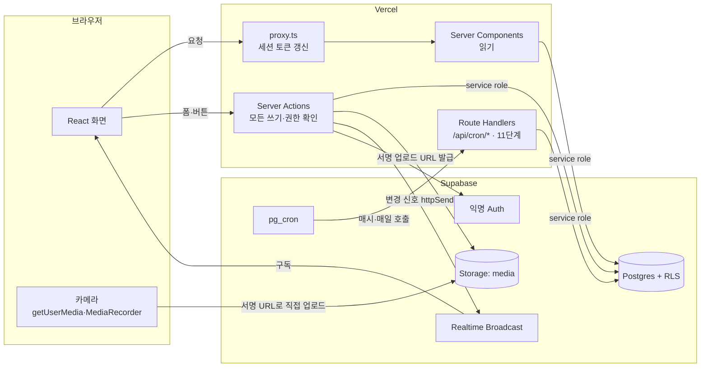
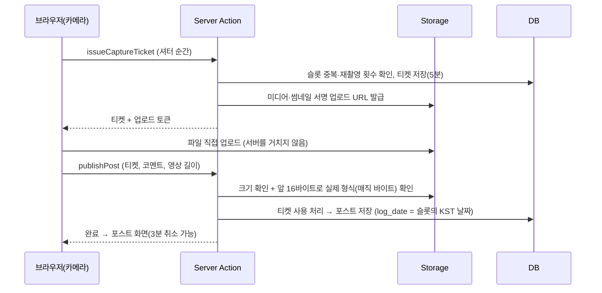
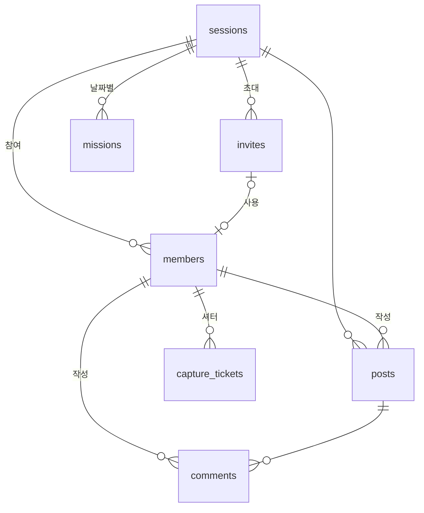

# daily-log

> 설치·가입 없이 **카톡 링크 하나로**, 친구들과 **매시간** 사진·짧은 영상을 함께 찍어 남기는 **오늘과 어제의 기록**.

- 프로덕션: https://daily-log-silk.vercel.app
- 요구사항·데이터 모델·화면 명세: [`docs/SPEC.md`](docs/SPEC.md) — 문서 안의 기능 ID(`S-4`, `P-5` 등)로 코드와 연결된다
- 작업 규칙(코딩 컨벤션, 금지 사항): [`CLAUDE.md`](CLAUDE.md)

---

## 목차

1. [어떤 서비스인가](#어떤-서비스인가)
2. [주요 기능](#주요-기능)
3. [화면 구성](#화면-구성)
4. [기술 스택](#기술-스택)
5. [아키텍처](#아키텍처)
6. [보안 모델](#보안-모델)
7. [데이터 모델](#데이터-모델)
8. [로컬 개발](#로컬-개발)
9. [환경 변수](#환경-변수)
10. [테스트](#테스트)
11. [배포](#배포)
12. [폴더 구조](#폴더-구조)
13. [진행 상황](#진행-상황)
14. [알려진 제약](#알려진-제약)

---

## 어떤 서비스인가

[셋로그(Setlog)](https://namu.wiki/w/%EC%85%8B%EB%A1%9C%EA%B7%B8)처럼 "매시간 지금 이 순간"을 함께 기록하는 서비스를 **웹**으로 만든다. 셋로그와 다른 점:

| | 셋로그 | daily-log |
|---|---|---|
| 시작 | 앱 설치 + 가입 | **링크 열고 닉네임만** |
| 인원 | 최대 6명 | **제한 없음** — 여행·MT·워크숍·결혼식 같은 단체 행사에 적합 |
| 보관 | 계속 쌓임 | **오늘과 어제만** — 부담 없이 날것으로 |
| 고유 기능 | 분할 화면 내보내기 | **하루 지도**(멤버 × 24시간), **오늘의 미션** |

핵심 규칙:

- 누구나 **세션**을 만들 수 있고, 만든 사람이 **방장**이다. 방장이 나가면 세션은 **폭파**(전부 삭제)된다.
- 방장이 만든 **일회용 초대 링크**(24시간)로 들어오고, **방장 승인** 후 멤버가 된다.
- 한 사람은 **1시간 슬롯마다 1개**, **카메라로 바로 찍은** 사진 또는 **2~10초 영상**만 올릴 수 있다. 갤러리 업로드는 없다.
- 올린 포스트는 **3분 안에만 취소**할 수 있고, 그 뒤에는 지울 수 없다.

## 주요 기능

| 영역 | 기능 | 명세 |
|---|---|---|
| 신원 | 로그인 없음 — 첫 행동 시 익명 신원 발급(쿠키), 세션별 닉네임 | ID-1~3 |
| 신원 | 카카오톡·인스타그램 등 **인앱 브라우저 감지 → 기본 브라우저로 열기** 안내 | ID-5 |
| 세션 | 만들기, 내 세션 목록, 방장 나가기 = 폭파(세션 이름 입력 확인) | S-1~5 |
| 초대 | 일회용 링크(해시 저장, 24시간, 방장 메모), 공유 시트·복사, 취소 | I-1~3 |
| 참여 | 닉네임 제출 → 승인 대기 → 승인 시 자동 입장 / 거절·만료·사용됨 안내 | I-4~10 |
| 멤버 | 승인·거절, 내보내기, 스스로 나가기(내 기록 전부 삭제) | I-5~9 |
| 촬영 | 앱 내 카메라(사진/영상, 전후면 전환), 10초 자동 정지, 2초 미만 차단, 코멘트 100자 | P-1~3 |
| 슬롯 | **셔터 시점의 서버 시각**으로 슬롯 확정, 슬롯당 1개, 5분 안에 게시 | P-4 |
| 타임라인 | 오늘/어제 탭, 슬롯별 썸네일, 현재 슬롯 카운트다운, 댓글 수 | P-5 |
| 포스트 | 크게 보기, **3분 안 올리기 취소**, 내 원본 저장 | P-5~6 |
| 댓글 | 100자, 내 댓글 삭제 시 "삭제된 댓글입니다" 흔적 | C-1~2 |
| 실시간 | 새 포스트·댓글·멤버 변화·폭파가 새로고침 없이 반영 | P-7 |
| 하루 지도 | 멤버 × 0~23시 점 그리드, 점을 누르면 그 포스트로 | M-1~2 |
| 미션 | 방장이 오늘의 한 줄 미션(50자)을 걸고 고침 | S-7 |
| 브이로그 | 하루치를 스토리처럼 이어 재생(전체/멤버별), 탭으로 이전·다음, 길게 눌러 일시정지 | V-1~3 |
| 내보내기 | 브라우저 안에서 9:16 영상(mp4/webm)으로 만들어 저장·공유 — 타이틀, 시간·닉네임·코멘트 자막, 영상 소리 포함 | V-4 |

## 화면 구성

| 경로 | 화면 |
|---|---|
| `/` | 홈 — 내 세션 목록(방장·승인 대기 표시), 새 세션 만들기 |
| `/new` | 세션 만들기 |
| `/join/[token]` | 초대 진입 — 닉네임 입력, 승인 대기, 링크 상태 안내 |
| `/s/[id]` | 타임라인 — 오늘/어제, 오늘의 미션, 슬롯별 포스트, 촬영 칸 |
| `/s/[id]/map` | 하루 지도 |
| `/s/[id]/vlog` | 브이로그 재생 · 영상으로 저장 (`?member=`로 멤버별) |
| `/s/[id]/capture` | 촬영 → 미리보기 → 코멘트 → 올리기 |
| `/s/[id]/p/[postId]` | 포스트 상세 — 미디어, 올리기 취소, 원본 저장, 댓글 |
| `/s/[id]/members` | 멤버 목록·나가기 / (방장) 초대 링크·승인 대기·내보내기 |

## 기술 스택

| 영역 | 선택 | 비고 |
|---|---|---|
| 프레임워크 | **Next.js 16** (App Router, Cache Components, `proxy.ts`) + TypeScript strict | 화면과 서버 로직(Server Actions)을 한 프로젝트에 |
| UI | Tailwind CSS v4 + shadcn/ui | 모바일 우선 |
| 신원 | **Supabase 익명 로그인** (`@supabase/ssr`, 쿠키) | 사용자에게는 로그인이 없다 |
| DB | Supabase Postgres + RLS | |
| 미디어 | Supabase Storage (비공개 버킷 `media`) | 서명 URL로 직접 업로드·조회 |
| 실시간 | Supabase Realtime Broadcast | 내용 없는 "변경 신호"만 |
| 정기 작업 | Supabase `pg_cron` + `pg_net` → `/api/cron/*` | Vercel Hobby의 하루 1회 제한 회피 |
| 검증·시간 | zod, date-fns + `@date-fns/tz` | 슬롯·날짜는 항상 KST |
| 테스트 | Jest + Testing Library + msw v2 | E2E 없음 |
| 배포 | Vercel (GitHub `main` → 프로덕션) | |

**모두 무료 플랜**(Supabase Free, Vercel Hobby)으로 운영한다.

## 아키텍처



### 설계 원칙

- **쓰기는 전부 서버에서.** 클라이언트에는 쓰기 권한이 없다(RLS에 INSERT/UPDATE/DELETE 정책 없음). 모든 변경은 Server Action이 권한을 확인한 뒤 service role로 수행한다.
- **익명 신원은 지연 발급.** 페이지를 열기만 해서는 신원을 만들지 않고, 세션 만들기·참여 같은 첫 행동에서 발급한다. 카카오톡 링크 미리보기 크롤러가 가짜 사용자를 만들지 않게 하기 위해서다.
- **실시간은 신호만.** 서버는 `{ type: "post.created" }`처럼 **내용 없는 신호**만 보내고, 화면은 신호를 받으면 권한이 걸린 조회로 다시 읽는다. 채널 이름을 알아도 멤버가 아니면 내용을 볼 수 없다. 신호를 놓쳐도 화면이 굳지 않도록 주기적으로도 다시 읽는다(대기 화면 10초, 그 외 30초, 탭 복귀 시).
- **슬롯은 서버 시각.** 셔터를 누르는 순간 서버에 **촬영 티켓**을 요청해 슬롯을 확정한다. 클라이언트 시계를 바꿔도 지난 슬롯에 올릴 수 없다.

### 촬영 → 게시 흐름



## 보안 모델

| 위협 | 대응 |
|---|---|
| 멤버가 아닌 사람이 데이터 조회 | RLS: `is_active_member()`일 때만 읽기. 서버 조회도 `requireMember()` 뒤에만 |
| 클라이언트가 직접 쓰기 | 쓰기 RLS 정책 없음 → service role(서버)만 가능 |
| 초대 링크 유출·재사용 | 원본 토큰은 링크에만, DB엔 SHA-256 해시. 조건부 UPDATE로 **원자적 1회 사용**, 24시간 만료 |
| 닉네임 사칭 | 세션 안 닉네임 유니크 제약 |
| 확장자 위조 업로드 | 게시 시 **매직 바이트**로 실제 형식 확인, 크기 상한(사진 5MB·영상 20MB·썸네일 1MB), 실패 시 파일 삭제 |
| 지난 슬롯에 올리기 | 서버 시각 기반 촬영 티켓, 5분 만료, 슬롯당 1개 유니크 제약 |
| 남용 | 세션 생성 시간당 5개, 재촬영 슬롯당 10회, 댓글 분당 20개, 미사용 링크 30개 |
| 비밀값 노출 | 서버 전용 키는 `NEXT_PUBLIC_` 없음, Vercel에는 Sensitive로 저장, `.env*`는 git·Vercel 업로드에서 제외 |
| 실수로 폭파 | 방장은 세션 이름을 정확히 입력해야 폭파 |

## 데이터 모델

마이그레이션: [`supabase/migrations/`](supabase/migrations). 자세한 컬럼은 [`docs/SPEC.md`](docs/SPEC.md#데이터-모델).



- 삭제는 **연쇄 삭제(cascade)** 로 처리한다. 멤버가 나가면 그 사람의 포스트·댓글이, 세션이 폭파되면 전부가 함께 지워진다. Storage 파일은 같은 경로 규칙(`{sessionId}/{memberId}/{postId}.{ext}`)으로 폴더째 지운다.
- 날짜(`log_date`)는 **KST** 기준이다. 자정을 넘긴 슬롯은 다음 날로 들어간다.

## 로컬 개발

### 준비물

- Node.js 24, pnpm 10 (npm 사용 금지)
- Supabase 계정 (Free) — 로컬 Docker 없이 **클라우드 프로젝트**를 개발에 쓴다

### 처음 한 번

```bash
pnpm install

# Supabase CLI 로그인 (대화형이라 일반 터미널에서 직접 실행)
pnpm exec supabase login

# 프로젝트 생성(서울) → 연결 → 익명 로그인 ON → 마이그레이션 → .env.local 작성
pnpm setup:supabase
```

`setup:supabase`는 중간에 실패해도 다시 실행하면 이어서 진행한다(`.env.local`의 `SUPABASE_PROJECT_REF` 기준). 비밀값은 화면에 출력하지 않는다.

### 매일

```bash
pnpm dev            # http://localhost:3000
```

> 휴대폰으로 카메라를 테스트하려면 HTTPS가 필요하다. 같은 와이파이의 `http://192.168.x.x:3000`에서는 카메라가 열리지 않으므로, 브랜치를 push해 **Vercel 미리보기 주소**로 확인한다.

### 스크립트

| 명령 | 설명 |
|---|---|
| `pnpm dev` | 개발 서버 |
| `pnpm build` / `pnpm start` | 프로덕션 빌드 / 실행 |
| `pnpm test` / `pnpm test:coverage` | Jest |
| `pnpm lint` / `pnpm typecheck` | ESLint · TypeScript 검사 |
| `pnpm setup:supabase` | Supabase 프로젝트 최초 구성 |
| `pnpm db:push` | 새 마이그레이션을 원격 DB에 적용 (로그인된 터미널) |
| `pnpm db:types` | DB 타입(`src/types/database.ts`) 재생성 (로그인된 터미널) |

### DB 스키마를 바꿀 때

1. `supabase/migrations/<타임스탬프>_<이름>.sql` 추가
2. `pnpm db:push`로 적용
3. `src/types/database.ts` 갱신 (`pnpm db:types` 또는 직접 수정)

## 환경 변수

`.env.example` 참고. `setup:supabase`가 `.env.local`을 만들어 준다.

| 이름 | 범위 | 용도 |
|---|---|---|
| `NEXT_PUBLIC_SUPABASE_URL` | 공개 | Supabase 주소 |
| `NEXT_PUBLIC_SUPABASE_PUBLISHABLE_KEY` | 공개 | 브라우저 읽기·Realtime 구독용 키 |
| `SUPABASE_SECRET_KEY` | **서버 전용** | service role — 모든 쓰기 |
| `CRON_SECRET` | **서버 전용** | `/api/cron/*` 호출 인증 |
| `NEXT_PUBLIC_VAPID_PUBLIC_KEY` / `VAPID_PRIVATE_KEY` / `VAPID_SUBJECT` | 공개 / **서버** / 서버 | 웹 푸시 |
| `NEXT_PUBLIC_SITE_URL` | 공개(선택) | 초대 링크 origin. 없으면 요청 헤더에서 만든다 |
| `SUPABASE_PROJECT_REF` / `SUPABASE_DB_PASSWORD` | 로컬 전용 | CLI 스크립트용. Vercel에는 올리지 않는다 |

## 테스트

```bash
pnpm test
```

- **유틸**(슬롯·KST 날짜, 매직 바이트, 인앱 브라우저 감지, 토큰): 경계값까지 단위 테스트
- **Server Actions**: Supabase를 흉내 내는 가짜 클라이언트(`src/test-utils/fake-supabase.ts`)로 권한·검증·부작용(신호, 파일 삭제)까지 확인
- **데이터 함수**: 하루 지도의 KST 시간 버킷팅 등
- **컴포넌트**: 카카오톡 UA에서 인앱 안내가 크래시 없이 뜨는지(실제 장애 재현 테스트)
- 외부 HTTP는 msw로 막는다(`onUnhandledRequest: "error"`)

## 배포

- GitHub `main`에 push → Vercel **프로덕션** 자동 배포
- 그 밖의 브랜치 → **미리보기** 배포 (Vercel 로그인 필요)
- 환경 변수는 Vercel 프로젝트에 등록돼 있다 (Production·Preview)
- `.vercelignore`로 `.env*` 업로드를 막는다

## 폴더 구조

```
src/
  app/                      라우트
    actions/                Server Actions (session, invite, member, post, comment, mission)
    join/[token]/           초대 진입
    new/                    세션 만들기
    s/[id]/                 타임라인 · capture · map · members · p/[postId]
  components/               화면 조각 (기능별 폴더, ui/는 shadcn 원본)
  hooks/                    use-signal(실시간 구독), use-now(1초 시계)
  lib/
    auth.ts                 requireUser / requireMember / requireHost
    data/                   서버 조회 함수 (권한 확인 뒤에만 호출)
    validators/             zod 스키마
    supabase/               server · client · admin · proxy
    media.ts                촬영·업로드 규칙, 매직 바이트
    slot.ts                 KST 슬롯·날짜 계산
    signals.ts / realtime.ts 실시간 신호 정의·발행
    in-app-browser.ts       인앱 브라우저 감지
  proxy.ts                  요청마다 Supabase 세션 갱신
supabase/
  migrations/               스키마 · RLS · Storage · cron
  config.toml               Auth 등 프로젝트 설정 (익명 로그인 ON)
scripts/setup-supabase.sh   최초 구성 스크립트
docs/SPEC.md                요구사항 명세
```

## 진행 상황

- [x] 1. 스캐폴딩
- [x] 2. DB 마이그레이션 + RLS + Storage
- [x] 3. 익명 신원 + 세션 만들기 + 홈
- [x] 4. 초대·승인·멤버 관리 + 인앱 브라우저 탈출
- [x] 5. 촬영 + 타임라인 + 올리기 취소
- [x] 6. 댓글 + 실시간
- [x] 7. 하루 지도 + 오늘의 미션
- [x] 8. 브이로그 재생 + 내보내기
- [ ] 9. 웹 푸시 + PWA
- [ ] 10. 기기 옮기기
- [ ] 11. Cron (보관 기간 정리 · 방장 14일 미접속 폭파 · 슬롯 알림)

## 알려진 제약

- **보관 기간 정리(D-1)와 방장 미접속 자동 폭파(S-6)는 11단계(Cron) 전까지 동작하지 않는다.** 그 전까지는 그저께 이전 데이터도 남아 있다.
- **기기를 바꾸거나 브라우저 데이터를 지우면 다른 사람으로 인식된다.** 10단계(기기 옮기기 코드)에서 복구 수단을 제공한다.
- 실시간 채널은 공개 채널이라, 내보내진 사람이 세션 ID를 알면 "언제 뭔가 올라왔다"는 **신호**는 볼 수 있다(내용은 볼 수 없음).
- 영상 길이(2~10초)는 브라우저에서 재고 서버는 범위만 확인한다. 의도적으로 조작한 클라이언트까지 막지는 않는다.
- 브이로그 내보내기는 **실제 재생 시간만큼** 걸리고, 탭이 백그라운드로 가면 브라우저가 그리기를 멈추므로 화면을 켜둬야 한다. `canvas.captureStream`이 없는 브라우저에서는 내보내기 버튼 대신 안내가 나온다.
- Vercel Hobby는 런타임 로그를 30분만 보관한다.
